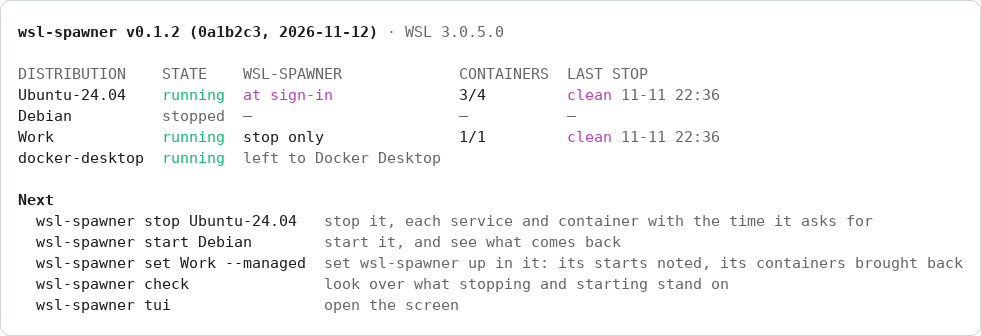

<p align="center">
  <picture>
    <source media="(prefers-color-scheme: dark)" srcset="docs/assets/logo-dark.svg">
    
  </picture>
</p>

<p align="center">
  <b>Give WSL's services and containers their time to stop when Windows shuts down, and bring back what was running.</b><br>
  A terminal screen and a CLI for every WSL 2 distribution on your PC.
</p>

<p align="center">
  <a href="https://github.com/kanggu12/wsl-spawner/actions/workflows/ci.yml"></a>
  <a href="https://github.com/kanggu12/wsl-spawner/releases"></a>
  <a href="LICENSE"></a>
  <a href="https://github.com/kanggu12/wsl-spawner/pkgs/container/wsl-spawner-demo"></a>
  
</p>

<p align="center">
  <a href="#quick-start">Quick start</a> |
  <a href="#why-wsl-spawner">Why</a> |
  <a href="#a-stop-step-by-step">A stop</a> |
  <a href="#the-screen">The screen</a> |
  <a href="#commands">Commands</a> |
  <a href="docs/README.md">Documentation</a> |
  <a href="#open-source">Open source</a>
</p>

<picture>
  <source media="(prefers-color-scheme: dark)" srcset="docs/assets/screen-dark.png">
  
</picture>

When WSL stops a distribution, by `wsl --terminate`, an idle timeout, an update or Windows signing out, its services get
about ten seconds; Docker's containers, a game server's save, a database's shutdown are cut off where they are.
wsl-spawner stops each distribution the slow way first, every service and container with the time it asks for, does it
by itself as Windows signs out, shuts down or restarts, and starts again what was running.

## Quick start

In PowerShell, on Windows 10 or 11 with WSL 2 ([requirements](docs/setup.md#requirements)):

```powershell
# Install for this user; it opens setup to choose how it works.
irm https://github.com/kanggu12/wsl-spawner/releases/latest/download/install.ps1 | iex

# In a new terminal. It only reads until you confirm a change.
wsl-spawner
```

The same `wsl-spawner` works in a WSL terminal opened after the install. With Scoop:
`scoop install https://github.com/kanggu12/wsl-spawner/releases/latest/download/wsl-spawner.json`.
[Setup](docs/setup.md#install) has every way to install and remove it.

To see it first, on any system with Docker, the screen on a made-up PC, where nothing real is read or changed:

```sh
docker run --rm -it ghcr.io/kanggu12/wsl-spawner-demo
```

`-e WSL_SPAWNER_LANG=ko` before the image name for Korean. Once installed, `wsl-spawner --demo` opens the same PC.

The first start opens a short wizard, a page for each choice, the language and colors shown as they are chosen.
`wsl-spawner setup` opens it again.

<picture>
  <source media="(prefers-color-scheme: dark)" srcset="docs/assets/setup-dark.png">
  
</picture>

## Why wsl-spawner

- **WSL gives services seconds.** Measured on WSL 3.0.5: `wsl --terminate` ends a distribution's services after about
  10 seconds, a `systemctl poweroff` inside after about 25. A service that needs longer is cut off.
- **Signing out is a stop too.** Windows signs out before every shutdown and restart, those an update makes too, and WSL
  goes with it. A sign-out hook is the one place to run first.
- **`docker stop` loses the restart policy.** A container stopped one by one is marked stopped by hand, and
  `unless-stopped` no longer brings it back. Stopping Docker's daemon keeps it, so that is what wsl-spawner stops.
- **A distribution with nothing open stops.** WSL ends it within half a minute of the last terminal closing (its idle
  timeout is 15 seconds), and its servers with it, unless something holds it.

## A stop, step by step

Inside the distribution, as root: the programs in `/etc/wsl-spawner/pre-stop.d`, the units in
`/etc/wsl-spawner/stop-units`, then Docker and Podman, each container with its own stop timeout, all within
`stop_limit` seconds (300 by default). Then WSL ends what is left. Distributions stop at the same time.

<picture>
  <source media="(prefers-color-scheme: dark)" srcset="docs/assets/stop-dark.png">
  
</picture>

What was running is noted inside the distribution. Where wsl-spawner is set up, a service of its own notes each start,
tells a stop of wsl-spawner's from one that cut the services short, and starts again the containers that were running
and are not back by their own restart policy.

## The screen

| Key | Does |
|:---|:---|
| `s` / `S` | stop the selected distribution / every one of wsl-spawner's, then WSL |
| `t` | start it, and see what came back |
| `m` `k` `l` `x` | set wsl-spawner up in it, keep it running, start it at sign-in, leave it to WSL |
| `c` / `h` | the check / the history |
| `?` | every key, and how it works |

Each change asks first, in a box that says what it does. The screen is drawn from the commands' JSON, the same in
PowerShell and in a WSL terminal, so everything on it is a command too. Started without a command, wsl-spawner opens
the screen, or in CLI mode prints the distributions and the commands to use next:

<picture>
  <source media="(prefers-color-scheme: dark)" srcset="docs/assets/cli-dark.png">
  
</picture>

## Commands

| Command | Does |
|:---|:---|
| `wsl-spawner` | the screen in TUI mode, the distributions and the commands to use in CLI mode |
| `status [--json]` | every distribution: running or not, what wsl-spawner does with it, its containers, its last stop |
| `stop NAME... \| --all [--shutdown] [--yes]` | stop the slow way, printing each step; `--shutdown` stops WSL after |
| `start NAME...` | start, and say which containers came back |
| `set NAME [--managed] [--keep] [--logon] [--skip]` | choose what wsl-spawner does with it; `=false` turns one off |
| `hook install \| remove \| status` | the sign-out hook, in the local Group Policy; installing it asks for an administrator |
| `check [--json]` | look over what stopping and starting stand on, and what to do about it |
| `history [--all] [--json] [--clear]` | the stops and starts so far: who asked, and how each distribution went |
| `setup` | the wizard; flags (`--mode cli`, `--stop-limit 600`, ...) set a choice without it |
| `uninstall [--purge]` | remove wsl-spawner and what it put on this PC |

[Commands](docs/commands.md) has every flag, the exit codes and the `--json` shapes.

## Settings

In `%APPDATA%\wsl-spawner\config.toml`, every key optional. Setup and `set` write them:

```toml
mode = "tui"              # what a bare wsl-spawner opens: "tui" or "cli"
skip = ["Scratch"]        # distributions left to WSL: never stopped or started by wsl-spawner
logon = ["Ubuntu-24.04"]  # started at sign-in, in this order, and kept running
resume = "running"        # what comes back: "running" (all that ran), "policy" (those with a restart policy), "off"
stop_limit = 300          # seconds a distribution's steps may take together
```

[Settings](docs/settings.md) has every key, the hooks and units a distribution stops first, and the files wsl-spawner
writes.

## How it compares

| | Services get their time | At sign-out and restart | Containers come back | Kept running | Says how it last stopped |
|:---|:---:|:---:|:---:|:---:|:---:|
| **wsl-spawner** | yes, each its own | yes, a sign-out hook | yes, by policy and by note | yes | yes |
| `wsl --terminate` | about 10 s | no | by policy only | no | no |
| `systemctl poweroff` inside | about 25 s | no | by policy only | no | no |
| Keep-alive scripts and tray apps | about 10 s | no | by policy only | yes | no |

wsl-spawner runs `wsl --terminate` itself, after its own steps.

## Questions

**Does it need an administrator?** Only to install or remove the sign-out hook, which lives in the local Group Policy.
Everything else runs as you.

**What does it change?** Inside a distribution, nothing until you set wsl-spawner up in it: then a service, a start
script and `/etc/wsl-spawner/pre-stop.d` for your own programs, a second service when it is kept running, and the stops
and starts it notes in `/var/lib/wsl-spawner`. On Windows, its settings and history, the
sign-in program when a distribution starts at sign-in, and the sign-out hook when you install it. `wsl-spawner check`
says what is there.

**Does it work with Docker Desktop?** Docker Desktop's distributions are its own: wsl-spawner leaves them be and says
so. So is the `docker` command its WSL integration puts in your distribution: wsl-spawner stops and brings back only a
Docker whose daemon runs in the distribution itself, Docker Engine inside it.

**What about rootless Podman or Docker?** wsl-spawner works as root, with root's engines: the containers of another
user's engine, rootless Podman's or rootless Docker's, are not seen, stopped or brought back.

**What about WSL 1?** A WSL 1 distribution has no VM and no systemd, nothing to give time to: it is listed, and left be.

**What if WSL updates itself?** An update stops WSL without a sign-out. wsl-spawner cannot run first then; `status`
and `check` say next time that the start ended without its time.

**How do I remove it?** `wsl-spawner uninstall`, in PowerShell or WSL. It takes out the hook, the sign-in program and
what it set up in the running distributions first. `--purge` removes the settings and the history too.

## Documentation

| Guide | What it covers |
|:---|:---|
| [Setup](docs/setup.md) | requirements, every way to install, upgrade and remove; Windows, WSL and PowerShell versions |
| [How it works](docs/how-it-works.md) | a stop, the sign-out hook, the start, keeping a distribution running, the start at sign-in, the check |
| [Commands](docs/commands.md) | every command and flag, the screen's keys, the `--json` shapes, the exit codes |
| [Settings](docs/settings.md) | `config.toml`, the hooks and units stopped first, the files wsl-spawner writes |
| [Troubleshooting](docs/troubleshooting.md) | a stop that runs out of time, a container that does not come back, a hook that does not run |
| [Internals](docs/internals.md) | the layers, what runs where, the decisions, the tests |

## Open source

MIT licensed. The tests run the scripts wsl-spawner sends into a distribution against made-up roots, and the commands
and the screen against a made-up WSL, so no change needs your own distributions.

- **Report a stop it got wrong** in [Issues](https://github.com/kanggu12/wsl-spawner/issues/new/choose), with the
  output of `wsl-spawner check` and `wsl-spawner history --json`.
- **Change the code**: [CONTRIBUTING.md](.github/CONTRIBUTING.md) maps the code and says what a change needs.
- **See what changed** in [CHANGELOG.md](CHANGELOG.md); report security problems as [SECURITY.md](.github/SECURITY.md)
  says.

```sh
git clone https://github.com/kanggu12/wsl-spawner && cd wsl-spawner
make check          # gofmt, go vet, staticcheck, shellcheck, the unit tests
make test-windows   # from WSL: every package again as a Windows program
go run ./cmd/wsl-spawner --demo
```

## License

MIT ([LICENSE](LICENSE)). The libraries wsl-spawner is built from, and the font of its logo, are listed with their
licenses in [THIRD_PARTY_NOTICES.md](docs/THIRD_PARTY_NOTICES.md).
