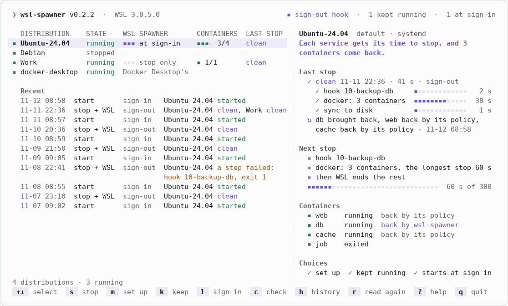
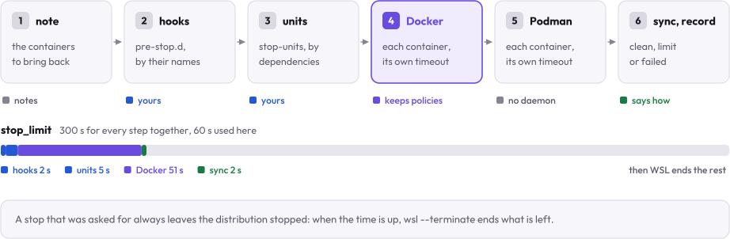
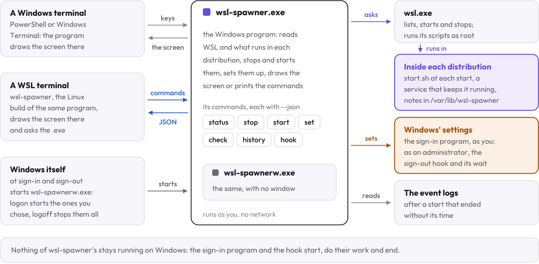

<p align="center">
  <picture>
    <source media="(prefers-color-scheme: dark)" srcset="docs/assets/logo-dark.svg">
    
  </picture>
</p>

<p align="center">
  <i>Give WSL's services and containers their time to stop when Windows shuts down, and bring back what was running.</i><br>
  A terminal screen and a CLI for every WSL 2 distribution on your PC.
</p>

<p align="center">
  <a href="https://github.com/kanggu12/wsl-spawner/actions/workflows/ci.yml"></a>
  <a href="https://github.com/kanggu12/wsl-spawner/releases"></a>
  <a href="LICENSE"></a>
  <a href="https://github.com/kanggu12/wsl-spawner/pkgs/container/wsl-spawner-demo"></a>
  
</p>

<p align="center">
  <a href="#install">Install</a> ·
  <a href="#what-it-does">What it does</a> ·
  <a href="#how-it-works">How it works</a> ·
  <a href="#documentation">Documentation</a>
</p>

<picture>
  <source media="(prefers-color-scheme: dark)" srcset="docs/assets/demo-dark.gif">
  
</picture>

When WSL stops a distribution, by `wsl --terminate`, an idle timeout, an update or Windows signing out, its services
get about ten seconds: Docker's containers and a database's shutdown are cut off where they are. wsl-spawner stops each
distribution the slow way first, every service and container with the time it asks for, does it by itself as Windows
signs out, shuts down or restarts, and starts again what was running.

## Install

In PowerShell, on Windows 10 or 11 with WSL 2:

```powershell
# Install for this user; it opens setup to choose how it works.
irm https://github.com/kanggu12/wsl-spawner/releases/latest/download/install.ps1 | iex

# In a new terminal. It only reads until you confirm a change.
wsl-spawner
```

The same `wsl-spawner` runs in a WSL terminal. [Setup](docs/setup.md) has Scoop, the zip and the requirements; to look
first, a [sandbox](docs/setup.md#try-it-in-a-sandbox) opens the screen on a made-up PC wherever Docker runs.

## What it does

- **Gives each service its time.** Your hooks and units first, then every container with its own stop timeout.
- **Runs as Windows signs out.** Its hook runs at every sign-out, shutdown and restart, an update's too.
- **Brings back what ran.** The containers that were running start again, their restart policies kept.
- **Keeps a distribution up.** WSL stops one with nothing open in it; wsl-spawner keeps it running, or starts it at
  sign-in.
- **Says how the last run ended.** A start cut short by an update or a crash is told apart, with what cut it.
- **Changes nothing unasked.** The screen and the CLI read until you confirm, and `check` says what to fix.

<picture>
  <source media="(prefers-color-scheme: dark)" srcset="docs/assets/steps-dark.svg">
  
</picture>

<p align="center"><i>A stop, step by step: all the steps share <code>stop_limit</code>, then WSL ends what is left.</i></p>

## How it works

<picture>
  <source media="(prefers-color-scheme: dark)" srcset="docs/assets/pieces-dark.svg">
  
</picture>

One Go program, built for Windows and for Linux: on Windows it does the work, and in WSL the same program is a launcher
that hands each command to `wsl-spawner.exe` and draws the screen from its JSON. It reaches a distribution only through
`wsl.exe`, as root, never starts one just to read it, and keeps no program running on Windows.
[How it works](docs/how-it-works.md) follows a stop and a start; [Internals](docs/internals.md) has the layers and the
tests.

## Documentation

| Using it | Understanding it | Changing it |
|:---|:---|:---|
| [Setup](docs/setup.md): install, upgrade, remove | [How it works](docs/how-it-works.md): a stop, the hook, a start | [Internals](docs/internals.md): the layers and the tests |
| [Commands](docs/commands.md): flags, keys, JSON | [Troubleshooting](docs/troubleshooting.md): what each finding means | [Contributing](.github/CONTRIBUTING.md): build, test, change |
| [Settings](docs/settings.md): `config.toml`, hooks | [Questions](docs/questions.md): rights, Docker Desktop, removal | [Changelog](CHANGELOG.md) · [Security](.github/SECURITY.md) |

## License

MIT ([LICENSE](LICENSE)). The libraries wsl-spawner is built from, and the font of its logo and figures, are listed
with their licenses in [THIRD_PARTY_NOTICES.md](docs/THIRD_PARTY_NOTICES.md).
