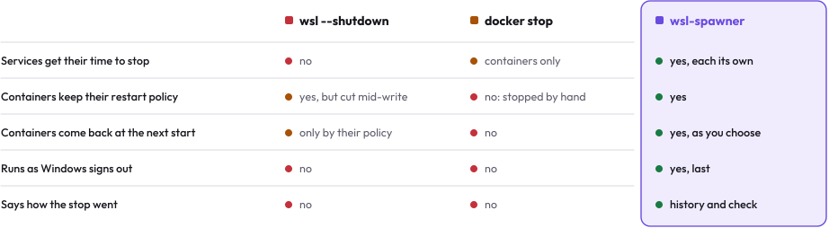
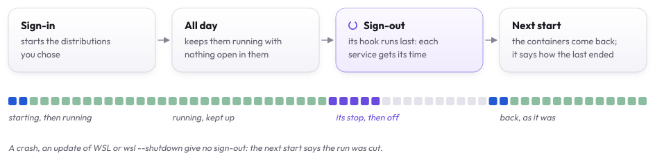
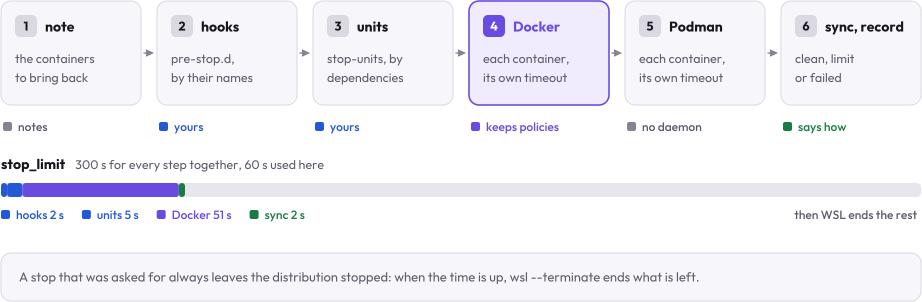
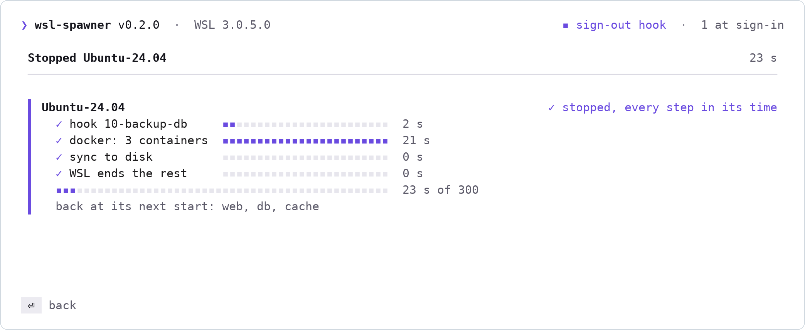
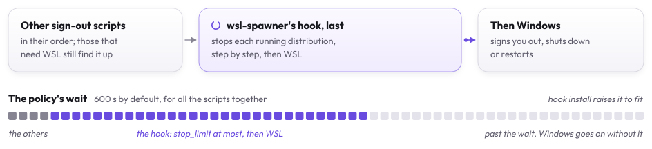
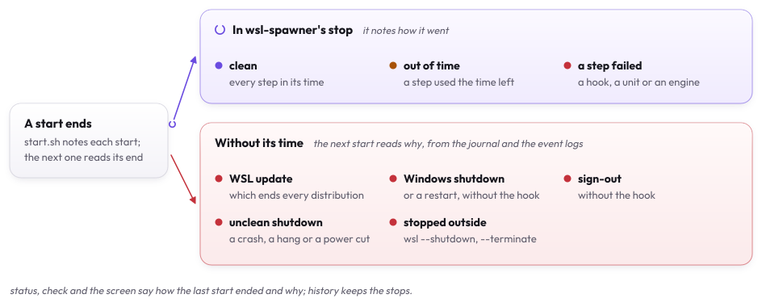

# How it works

wsl-spawner runs on Windows (`wsl-spawner.exe`), and in a WSL terminal through a launcher that hands each command to it.
It reaches a distribution only through `wsl.exe`, as root, with scripts of its own; it never starts a distribution
that does not run just to read it, nor Docker's daemon: one stopped by hand, with only its socket listening as Docker's
packages leave it, is not asked anything, as asking would start it, and reads as asleep. What a distribution says
(a hook's name, a container's name) is shown with every control character turned into a question mark.

## Why wsl-spawner

- **WSL gives services seconds.** `wsl --terminate` and a `systemctl poweroff` inside end a distribution's services
  within seconds ([measured](#how-it-compares)); a service that needs longer is cut off.
- **Signing out is a stop too.** Windows signs out before every shutdown and restart, those an update makes too, and WSL
  goes with it: a sign-out hook is the one place to run first.
- **`docker stop` loses the restart policy.** Stopping Docker's daemon keeps it, so that is what wsl-spawner stops
  ([why](#why-not-docker-stop)).
- **A distribution with nothing open stops.** WSL ends it within half a minute of the last terminal closing, and its
  servers with it, unless something holds it ([keeping one running](#keeping-a-distribution-running)).
- **A cut start says nothing.** After an update or a crash, the services just ended. wsl-spawner notes each start and
  each of its stops, so the next start knows how the last one ended, and reads what ended it when it was not its stop.

## How it compares

Each way of stopping a distribution, the seconds measured on WSL 3.0.5:

| | Services get their time | At sign-out and restart | Containers come back | Kept running | Says how it last stopped |
|:---|:---:|:---:|:---:|:---:|:---:|
| **wsl-spawner** | yes, each its own | yes, a sign-out hook | yes, by policy and by note | yes | yes, and what cut it |
| `wsl --terminate` | about 10 s | no | by policy only | no | no |
| `systemctl poweroff` inside | about 25 s | no | by policy only | no | no |
| Keep-alive scripts and tray apps | about 10 s | no | by policy only | yes | no |

wsl-spawner runs `wsl --terminate` itself, after its own steps.

### Why not `docker stop`

<picture>
  <source media="(prefers-color-scheme: dark)" srcset="assets/compare-dark.svg">
  
</picture>

A container stopped by `docker stop` is marked as stopped by hand, and `unless-stopped` no longer starts it when Docker
starts. The daemon's own stop does not mark it, and gives each container its own stop timeout, waiting for the
slowest. That is what wsl-spawner asks for, with enough time.

## A day with wsl-spawner

<picture>
  <source media="(prefers-color-scheme: dark)" srcset="assets/day-dark.svg">
  
</picture>

No program of wsl-spawner's stays running on Windows: the sign-in program starts the distributions and ends, and the
sign-out hook runs and ends. Keeping a distribution running is a service inside it, which holds Windows' own
`waitfor.exe` open, as Task Manager shows. Each part is a choice, per distribution: stop only, set up (a start script
that brings the containers back), kept running, started at sign-in.

## A stop

<picture>
  <source media="(prefers-color-scheme: dark)" srcset="assets/steps-dark.svg">
  
</picture>

`wsl-spawner stop NAME`, `s` and `S` on the screen, and the sign-out hook all stop a distribution the same way. A script runs
inside it as root, and says each step as it goes. One stop runs in a distribution at a time: a second one, as the
sign-out hook's while a stop asked by hand is at work, finds the first's lock in `/run`, changes nothing and leaves the
distribution to it; with `--shutdown`, WSL's own stop waits for that first stop to end.

1. **The containers to bring back are noted** in `/var/lib/wsl-spawner/resume`, before anything stops, so a stop cut
   short still brings them back: every running container (`resume = "running"`), or those with a restart policy of
   `always` or `unless-stopped` (`"policy"`), or none (`"off"`). One run with `--rm` is not, as its engine removes it
   as it stops; those of an engine that does not answer stay as the last start left them. Only where wsl-spawner is
   set up.
2. **Hooks.** Every executable file in `/etc/wsl-spawner/pre-stop.d`, in the order of their names, each with the time
   left. Their output is not kept; a hook that wants a log writes its own.
3. **Units.** The systemd units `/etc/wsl-spawner/stop-units` names, one per line, those that are running, in one
   `systemctl stop`: systemd orders them by their dependencies and gives each its own `TimeoutStopSec`. Containers a
   hook or a unit removed, as `docker compose down` does, are then taken off the list to bring back.
4. **Docker.** Its daemon is stopped by systemd, `docker.socket` first so nothing starts it again. The daemon stops
   every container itself, each with its own stop timeout, and does not mark them stopped by hand, so `unless-stopped`
   and `always` bring them back when the daemon starts. systemd would end the daemon at its own stop timeout (90
   seconds by default): for this stop, a drop-in in `/run` gives it all the time left. With `live-restore` on, the
   daemon leaves its containers running, so they are stopped first, each with its own timeout. Without systemd, the
   daemon `/var/run/docker.pid` names gets `TERM` and is waited for, when that process is `dockerd`. A `docker` that
   answers for a daemon that is not this distribution's own, as Docker Desktop's integration and a `podman-docker`
   shim do, is left alone: its containers are not stopped, listed or brought back.
5. **Podman.** It has no daemon: its running containers are stopped, each with its own stop timeout.
6. **Sync.** `journalctl --sync` and `sync`, so what the services wrote is on the disk.
7. **The record.** `/var/lib/wsl-spawner/last-stop`: which start of the distribution it stopped, when, how long it
   took, how it ended (`clean`, `limit` when a step ran out of the time left, `failed` when one failed) and who asked.
   Only where wsl-spawner is set up. Each of the stop's own files is written beside the old one and moved into its
   place: where one cannot be written, as on a full disk, the old one stays and the stop ends `failed`, with a step
   `record` that says so.

Each step gets `TERM` when its time is up; one that goes on is killed 5 seconds later, where the distribution's
`timeout` can do that, and a step that went on past its time ran out of it, whatever it returned.

Every step together has `stop_limit` seconds, 300 by default. Then wsl-spawner runs `wsl --terminate`: WSL ends what is
left, with the few seconds it gives. A stop that was asked for always leaves the distribution stopped, Ctrl+C included:
`wsl-spawner stop` stops waiting for the steps and WSL ends what is left; on the screen Ctrl+C says the stop goes on to
its end, and the screen closes as it ends.

The screen shows each step as it runs, with its time as a bar, and the stop's whole time against `stop_limit`:

<picture>
  <source media="(prefers-color-scheme: dark)" srcset="assets/stop-dark.png">
  
</picture>

Distributions stop at the same time. `--shutdown`, `S` and the sign-out hook then run `wsl --shutdown`, which stops
every distribution, wsl-spawner's or not, and WSL's VM.

The terminal a stop is asked from may run in a distribution it stops. The stop then goes on in a copy of wsl-spawner
with no console, which the terminal's end does not end, and the history says how it went.

## The sign-out hook

<picture>
  <source media="(prefers-color-scheme: dark)" srcset="assets/signout-dark.svg">
  
</picture>

`wsl-spawner hook install` adds a sign-out script to the local Group Policy, after any other: `wsl-spawnerw.exe logoff`,
the build of wsl-spawner with no console, so no window opens. Windows runs the sign-out scripts as you sign out, and
before every shutdown and restart, those an update makes too, and waits for them, up to the policy's wait for all of
them together (600 seconds by default): the hook, last, has what the others leave. Where that wait is less than
`stop_limit` and a minute, `hook install` raises it, as an administrator, to `stop_limit`, a minute for WSL to end and a
minute for each other sign-out script, PowerShell's too, in whole minutes. It writes the policy's value
(`HKLM\Software\Policies\Microsoft\Windows\System`, `MaxGPOScriptWait`), and notes what was there first under
`HKLM\Software\wsl-spawner`; `hook remove` and `uninstall` put that back, as long as the wait is still the one it set
and no other copy's hook stays: one changed since is someone else's, and stays. A standard user's hook is an
administrator's install: its wait is the administrator's, and is left as it is. The hook stops every running
distribution of wsl-spawner's as above, then WSL. Windows runs the PowerShell sign-out scripts (`psscripts.ini`) after
these unless it is set to run them first, and a domain's after the local ones: `hook status` lists the PowerShell ones
and the order the policy gives them.

It writes `C:\Windows\System32\GroupPolicy\User\Scripts\scripts.ini` and counts the change in `gpt.ini`, both kept once
as `*.before-wsl-spawner` (an empty copy where there was none); both change, or neither. That needs an administrator:
run as you, wsl-spawner starts the change as one, and Windows asks. Then, as you, it has Windows read your policy
(`gpupdate /target:user`); if that fails, the change counts from your next sign-in, and the command ends with
exit code 3. Every other sign-out script stays as Windows runs it: those it runs are indexed again from 0, and one after
a missing index still does not run. A `scripts.ini` or `gpt.ini` wsl-spawner cannot read for certain as Windows does is
left as it is, and the command says why. The hook and a sign-in program need wsl-spawner on a fixed disk of this PC.
The hook, which is in a policy for every user of the PC and runs as whoever signs out, an administrator among them,
also needs wsl-spawner where no one but you, the system and the administrators can write: it checks the owner and the
access list of the program, its folder and every folder above, and refuses to install otherwise, naming who may change
what. The install script's own folder, under your profile, is such a place; a folder made under a drive's root, such as
`C:\tools`, usually lets every user write in it. Who may delete a drive's root is not counted, as a root is never
deleted. Links and junctions on the way are followed to where they lead, and checked there too. A standard user's
hook would run, as an administrator signs out, a program that user could change, so only the administrators may write
there: an administrator's install under Program Files ([For a standard user](setup.md#for-a-standard-user)). `check` says it of
a hook already installed, with that hook's own way out.

Another copy's hook, one an install moved elsewhere or a second install left, is told apart. `hook install`,
`hook remove` and `uninstall` take out one whose program is gone, and say so first; one whose program is there, or
another account's, stays, and its own copy takes it out. Taking the hook out needs no `wsl-spawnerw.exe`: when it is
gone, Windows starts `wsl-spawner.exe` as the administrator instead.

A Windows update of WSL itself, `wsl --shutdown` typed by hand, or a crash stop WSL without a sign-out: the hook cannot
run first. `status` and `check` say next time that the start ended without its time, and, where they can tell, what
ended it. The distribution's journal holds that start's last lines: when it ended, and whether it was asked to power
off, as WSL asks a distribution it ends (systemd's `Shutting down.` as PID 1, or WSL's own line in the kernel's log when
the power off ran out of its time), or went without a word. Only lines as journalctl starts an entry count, and only
those two say it was asked: a line any program logs carries its own PID. Its moments are set to Windows' clock first, by
how far the distribution's clock was off it as it was read. Windows' event logs hold what happened then:

| What | Windows' events | Fits a start that |
| --- | --- | --- |
| Windows did not shut down cleanly | Kernel-Power 41, a bugcheck's 1001 and EventLog 6008 (with Windows' last stamp of being alive), logged at the boot after | went without a word, the boot after it the first since, with no shutdown or sign-out before it |
| WSL was updated | Windows Installer's and Windows Update's events that name WSL | ended within the install, from its first event to its last |
| Windows shut down or restarted | User32 1074, EventLog 6006, Kernel-Power 109, Kernel-General 13 | ended about then, asked to power off or not |
| You signed out | Winlogon 7002, yours | ended about then, asked to power off or not |

The earliest that fits is what ended it; none, and it was stopped outside wsl-spawner (`wsl --shutdown`, `wsl --terminate`,
or WSL itself). A Windows event alone does not say it: a start may end long before Windows next shuts down. The logs are
read only, as any user signed in may, within a few seconds; one that cannot be read leaves it unsaid. Updates are read
for the first 20 minutes after the start ended, as other programs' installs fill the log. What it says is a hint, not
proof: any program a signed-in user runs may write an event of Windows Installer's.

## The start

`wsl-spawner set NAME --managed` sets wsl-spawner up in a distribution: a start script,
`/usr/local/lib/wsl-spawner/start.sh`, and `wsl-spawner.service`, which runs it at each start, after Docker (snap's too)
and Podman. The script:

- **notes the start** in `/var/lib/wsl-spawner/runs`, the last 20 kept. A start is the kernel's boot and the moment the
  distribution's init started: a distribution stopped and started again in one VM keeps the boot and gets a new start.
- **starts again the containers the last stop noted** that are still there and not running (those with a restart
  policy may be back already), and looks a moment later: one that ended at once did not come back. Podman's containers
  start in a scope of their own, which systemd does not end with the service. What became of each is kept in
  `/var/lib/wsl-spawner/resumed`. A Docker daemon systemd is still starting is waited for, a minute at most; the
  containers of an engine that does not answer stay to bring back the next time the service runs. A stop that runs
  meanwhile writes its own list, which stands. One run of the script at a time: a second one leaves it all to the
  first.

Setting up starts that service and does not wait for it, so a set-up never takes longer than WSL lets a command run,
however long an engine takes to answer.

How the start before this one ended is then known: the last stop's record names a start; when it is the one before
this, wsl-spawner stopped it, and its record says how; when it is not, that start ended without wsl-spawner's stop.

<picture>
  <source media="(prefers-color-scheme: dark)" srcset="assets/ends-dark.svg">
  
</picture>

What ended a start without wsl-spawner's stop is read as [the sign-out hook](#the-sign-out-hook) says, from the
distribution's journal and Windows' event logs.

`wsl-spawner set NAME --managed=false` takes all of it out again; the hooks and `stop-units` stay, as they are yours.

## Keeping a distribution running

WSL stops a distribution within half a minute of nothing from Windows running in it (`.wslconfig`'s
`instanceIdleTimeout`, 15 seconds by default). `wsl-spawner set NAME --keep` adds `wsl-spawner-keepalive.service`,
which holds Windows' `waitfor.exe` waiting for a signal no one sends: WSL keeps a distribution up while one of its
programs runs, and ends that program with it. Any program on the PC can wait for or send a signal of any name, so the
name ends with a secret made at each set-up, kept only in the service's file. Windows programs must run in the
distribution (`[interop]` in `/etc/wsl.conf`).

## The start at sign-in

`wsl-spawner set NAME --logon` adds `NAME` to `logon` in the settings, keeps it running, and adds a sign-in program,
`"wsl-spawnerw.exe" logon`, under `HKCU\Software\Microsoft\Windows\CurrentVersion\Run`. Windows starts it as you sign
in, Task Manager's Startup apps lists it, and it starts the distributions in their order. The program goes when no
distribution starts at sign-in.

## The check

`wsl-spawner check` reads, and changes nothing: the sign-out hook, whether it runs last, another sign-out script that
stops WSL before it, Windows' wait against `stop_limit`; each running distribution's systemd and failed units, whether
wsl-spawner is set up, how its last start ended, keeping it running without Windows programs, engines that do not
answer, containers that wait longer than the limit or would not come back, and its clock against Windows'; the sign-in
program; WSL's version and the `.wslconfig` settings that bear on this; and published ports inside the ranges Windows
keeps from programs (`netsh interface ipv4 show excludedportrange`). Each finding says what to do.

## Distributions it leaves be

Docker Desktop's, Rancher Desktop's and Podman's machine distributions are their tools': wsl-spawner lists them and
leaves them be. A WSL 1 distribution has no VM and no systemd. `skip` in the settings leaves any other to WSL.
