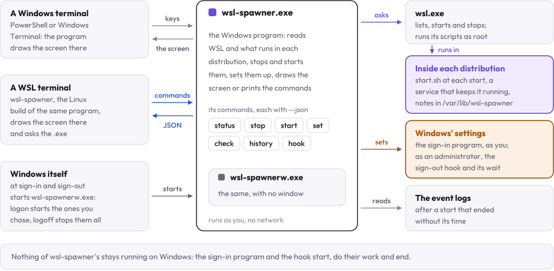
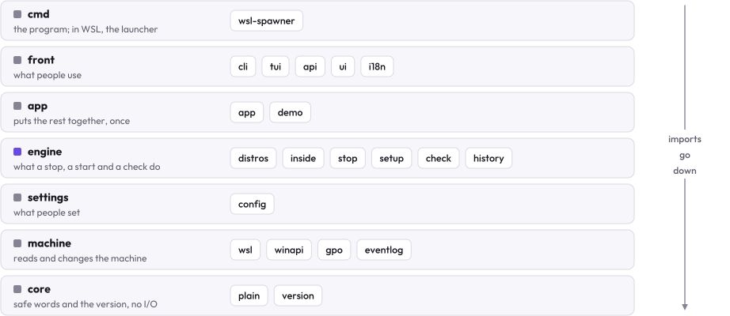
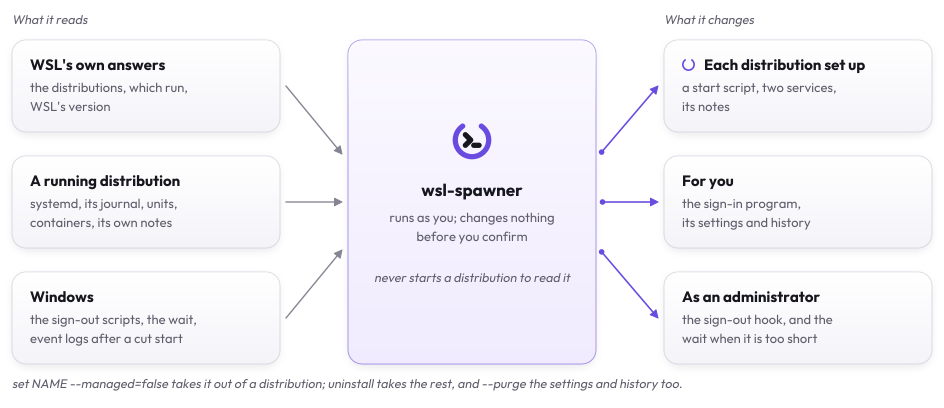
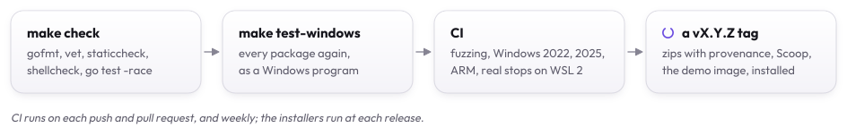

# Internals

How wsl-spawner, one Go program built for Windows and for Linux, is put together: what runs where, the layers of the
code, what it reads and changes, the decisions behind them, and the tests and CI that hold them.

## What runs where

<picture>
  <source media="(prefers-color-scheme: dark)" srcset="assets/pieces-dark.svg">
  
</picture>

| Where | What | How |
|:---|:---|:---|
| Windows | `wsl-spawner.exe`: the commands, and the screen when started in PowerShell or cmd | as you; started again with no console for a stop that goes on without its terminal |
| Windows | `wsl-spawnerw.exe`: the same program with no console | the sign-in program (`logon`), the sign-out hook (`logoff`), a change of the hook as the administrator |
| WSL | `wsl-spawner`: the Linux launcher | hands each command to `wsl-spawner.exe`; draws the screen and setup's wizard itself, asking `wsl-spawner.exe` for each answer |
| A distribution | the probe, the stop script, the set-up and removal scripts, the read of its journal after a start that was cut | `wsl.exe -d NAME -u root --exec sh -c SCRIPT`, from Windows' folder |
| A distribution, set up | `start.sh`, run by `wsl-spawner.service` at each start; `wsl-spawner-keepalive.service` | systemd |

The scripts are POSIX sh with only the shell to pick text apart, as a small distribution may have no `awk` or `sed`;
the tests run them with nothing else on the PATH. The read of the journal alone uses `grep` and `cut`, which a
distribution with `journalctl` has. Each prints `KEY=VALUE` lines, which the Windows side reads; a key it
does not know is skipped, so a newer script can say more.

## The layers

The code under `internal/` sits in layers. Imports go down, never up; `internal/layers_test.go` fails when one goes up.

<picture>
  <source media="(prefers-color-scheme: dark)" srcset="assets/layers-dark.svg">
  
</picture>

| Layer | Packages | |
|:---|:---|:---|
| cmd | `cmd/wsl-spawner` | the program; in WSL, the launcher that hands each command to `wsl-spawner.exe` |
| front | `cli`, `tui`, `api`, `ui`, `i18n` | the commands, the screen and setup, the commands' JSON and its client, colors and marks, words |
| app | `app`, `app/demo` | the settings, WSL and this PC put together; a made-up PC for the demo and the tests |
| engine | `distros`, `inside`, `stop`, `setup`, `check`, `history` | the distributions and what runs in them, the scripts run inside, a stop, set-up and taking out, the check, the history |
| settings | `config` | `config.toml`, and writing keys into it as written by hand |
| machine | `wsl`, `winapi`, `gpo`, `eventlog` | `wsl.exe` and WSL's registry, Windows' calls, the local Group Policy's files and the policy's wait, Windows' event logs |
| core | `plain`, `version` | what a distribution says made safe to show, the build's version |

## What it reads and changes

<picture>
  <source media="(prefers-color-scheme: dark)" srcset="assets/touches-dark.svg">
  
</picture>

It reads without asking: WSL's own answers, and in a running distribution, as root, systemd, its journal, the units,
the containers and its notes. It changes nothing before you confirm, or before a command you typed asks for that
change: inside a distribution, only what setting it up puts there; on Windows, its settings and history, the sign-in
program under your `Run` key, and as an administrator the sign-out hook and the policy's wait.
[Settings](settings.md#the-files-wsl-spawner-writes) lists every file.

## Decisions

- **The screen stands on the commands' JSON alone** (`api.Client`). In the Windows program each command is the program
  started again; in a WSL terminal the launcher draws the screen there and starts `wsl-spawner.exe` for each command,
  as the Windows program reaches a WSL terminal only through pipes, which take no keys and no size. The screen can do
  nothing a command cannot, so a script can do all of it. The demo runs the same commands in its own process, on a
  made-up PC.
- **Windows and WSL are each one interface.** WSL is `wsl.System`; everything the program reaches on Windows besides
  WSL is the App's `PC`: the sign-out scripts, the sign-in programs, a few files and commands, this program started
  again. Each test gives its App a made-up PC whose every call fails unless the test gave it, and a made-up WSL
  (`wsl.Fake`), so no test can reach the PC it runs on by a path it forgot.
- **Docker's daemon is stopped, not its containers**, with systemd given the time left: a container stopped by hand
  loses its restart policy's start.
- **A start is the kernel's boot and the init's start**: a distribution stopped and started again keeps the VM's boot.
- **No program of wsl-spawner's stays running on Windows.** The sign-in program starts the distributions and ends;
  keeping one running is a service inside it, which holds Windows' own `waitfor.exe` open; the sign-out hook runs and
  ends.
- **A distribution is never started to be read.** One that does not run says nothing about what runs in it, and
  Docker's daemon stopped by hand is not woken to be asked.
- **The engines are root's.** The scripts run as root and ask root's engines: the containers of another user's engine,
  rootless Podman's or rootless Docker's, are not seen, stopped or brought back.

## The tests and CI

<picture>
  <source media="(prefers-color-scheme: dark)" srcset="assets/release-dark.svg">
  
</picture>

- **The scripts** run under the test machine's `sh` against made-up roots: a temporary folder stands for `/`, with
  made-up `systemctl`, `docker`, `podman` and `wslpath`. `internal/engine/inside/main_test.go` fails the run when a
  path of the machine's own appears during it.
- **The commands** run against a made-up WSL (`wsl.Fake`) and a made-up PC: a stop's plan, question, steps and history;
  set-up and taking out; the hook's scripts.ini; uninstall's every step and what stops it.
- **The screen and setup** are drawn in every state, at sizes from 160x40 to 40x12, in English and Korean, from the
  demo's PC: every line exactly the width, the screen exactly the height, no word left a key. The theme's colors are
  measured against their backgrounds: 4.5:1 for words.
- **On Windows** (`make test-windows`), every package again as a Windows program: the Windows calls, and that no test
  changes the PC or starts a program.
- **End to end** (CI, on Windows Server 2025): a throwaway distribution with systemd and a service that takes 40 seconds
  to stop, stopped by the program built from the commit, which waits for it; set up, kept running, started again; the sign-out hook
  installed, read back and removed.

CI (`.github/workflows`) runs on each push to main and each pull request, and weekly; the installers and the release
run at a release:

| Workflow | Runs |
|:---|:---|
| `ci.yml` | `make check`, fuzzing, govulncheck and the third-party notices on Linux; the zips and the demo image; every package on Windows Server 2022, 2025 and Windows 11 on Arm; `install.ps1` in PowerShell 7, Windows PowerShell 5.1 and on Arm |
| `wsl.yml` | on Windows Server 2025, a lab distribution with systemd and three containers: a stop that gives each its time, a start that brings them back, WSL alone cutting it short and the next look saying so, an update of WSL named, the sign-out hook and the sign-in program run as Windows runs them, the wait raised and put back |
| `installers.yml` | at a release: the release's own zips installed as you, as a standard user from an administrator's install, with Scoop, and the demo image |
| `release.yml` | at a `vX.Y.Z` tag: CI, then the zips with provenance, the Scoop manifest and the demo image, then `installers.yml` |
| `canary.yml` | weekly, `wsl.yml` on WSL's newest pre-release, as an early warning |
