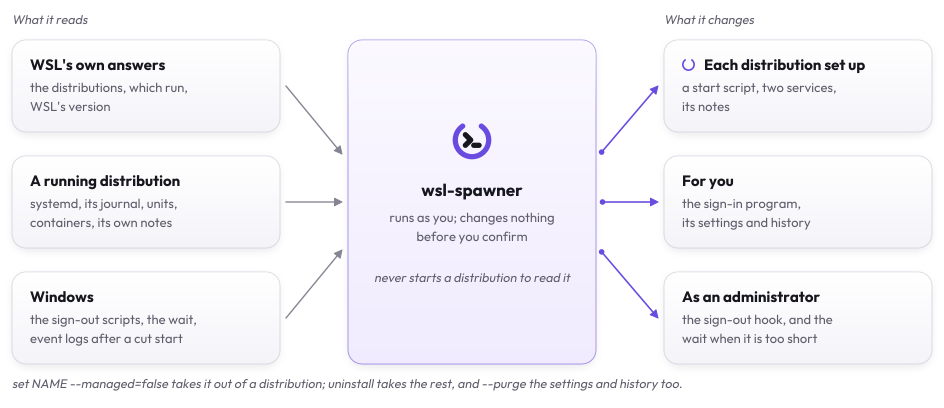

# Questions

## Does it need an administrator?

Only to install or remove the sign-out hook, which lives in the local Group Policy, with the policy's wait for sign-out
scripts when it is too short for the stop ([the sign-out hook](how-it-works.md#the-sign-out-hook)). Everything else
runs as you.

## Does signing out take longer?

As long as the stops take: Windows shows its sign-out screen while the hook gives each service and container its time,
`stop_limit` at most, then a few seconds for WSL. A distribution with nothing slow to stop is done in seconds.
`wsl-spawner history` says how long each took.

## What does it change?

Inside a distribution, nothing until you set wsl-spawner up in it: then a service, a start script and
`/etc/wsl-spawner/pre-stop.d` for your own programs, a second service when it is kept running, and the stops and starts
it notes in `/var/lib/wsl-spawner`. On Windows, its settings and history, the sign-in program when a distribution starts
at sign-in, and the sign-out hook when you install it. `wsl-spawner check` says what is there, and
[Settings](settings.md#the-files-wsl-spawner-writes) lists every file.

<picture>
  <source media="(prefers-color-scheme: dark)" srcset="assets/touches-dark.svg">
  
</picture>

## Does it work with Docker Desktop?

Docker Desktop's distributions are its own: wsl-spawner leaves them be and says so. So is the `docker` command its WSL
integration puts in your distribution: wsl-spawner stops and brings back only a Docker whose daemon runs in the
distribution itself, Docker Engine inside it.

## What about rootless Podman or Docker?

wsl-spawner works as root, with root's engines: the containers of another user's engine, rootless Podman's or rootless
Docker's, are not seen, stopped or brought back.

## What about WSL 1?

A WSL 1 distribution has no VM and no systemd, nothing to give time to: it is listed, and left be.

## What if WSL updates itself, or Windows crashes?

Nothing runs first then. In a distribution wsl-spawner is set up in, `status`, `check` and the screen say next time that
the start ended without its time, and, from the distribution's journal and Windows' event logs, what ended it: a WSL
update, a shutdown or a sign-out without the hook, a crash, or a stop outside wsl-spawner
([how it is read](how-it-works.md#the-sign-out-hook)).

## Why did my terminal close?

It ran in the distribution you stopped. The stop goes on in a copy of wsl-spawner with no window, which the terminal's
end does not end, and `wsl-spawner history` says how it went.

## Does it work with wsl-shrinker?

[wsl-shrinker](https://github.com/kanggu12/wsl-shrinker) 0.7 and later stop a distribution through wsl-spawner where it
is installed, so its hooks, units and containers get their time before a disk is compacted. Those stops are listed in
the history as asked by hand.

## How do I remove it?

`wsl-spawner uninstall`, in PowerShell or WSL. It takes out the hook, the sign-in program and what it set up in the
running distributions first. `--purge` removes the settings and the history too. [Setup](setup.md#remove) has the rest,
for a distribution that does not run and for Scoop.
