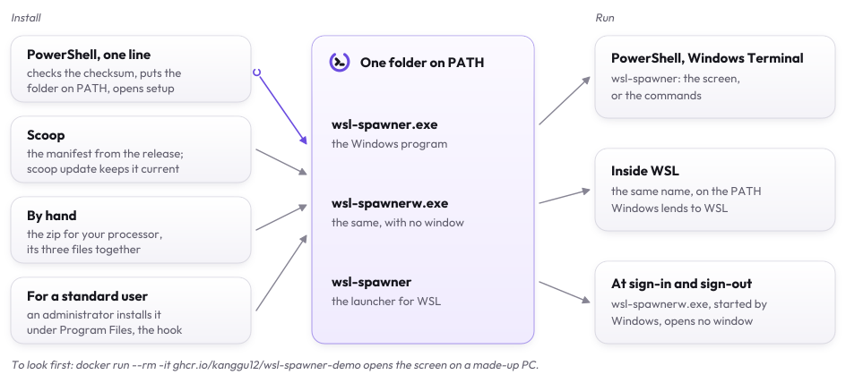
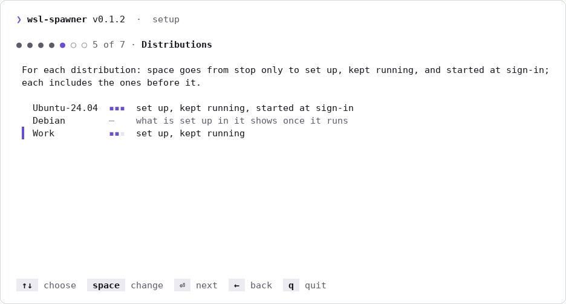

# Setup

## Requirements

- **Windows 10 or 11**, x64 or ARM64, with **WSL 2**. A WSL 1 distribution is listed and left be.
- **systemd** in the distributions you set wsl-spawner up in (`[boot] systemd=true` in `/etc/wsl.conf`): the start
  script and the keep-running service are systemd's. A stop works without it.
- **Windows programs in WSL** (`[interop] enabled=true`, WSL's default) for keeping a distribution running.
- **The sign-out hook** uses the local Group Policy's sign-out scripts, which Windows 10 and 11 Pro, Enterprise and
  Education run. On Windows Home it installs as well; whether Home runs it has not been seen, so `wsl-spawner history`
  after a sign-out says whether it ran. Installing and removing it needs an administrator.
- **PowerShell** 5.1 (Windows' own) or 7 for `install.ps1`.

## Try it in a sandbox

On any system with Docker, the screen on a made-up PC, where nothing real is read or changed:

```sh
docker run --rm -it ghcr.io/kanggu12/wsl-spawner-demo
```

`-e WSL_SPAWNER_LANG=ko` before the image name for Korean. Once installed, `wsl-spawner --demo` opens the same PC.

## Install

<picture>
  <source media="(prefers-color-scheme: dark)" srcset="assets/ways-dark.svg">
  
</picture>

In PowerShell, as you, not as an administrator:

```powershell
irm https://github.com/kanggu12/wsl-spawner/releases/latest/download/install.ps1 | iex
```

It picks the build for the PC's processor, checks it against the release's `checksums.txt`, puts `wsl-spawner.exe`,
`wsl-spawnerw.exe` (the same program with no console, which the sign-in program and the sign-out hook start) and the
WSL launcher `wsl-spawner` in `%LOCALAPPDATA%\Programs\wsl-spawner`, adds that folder to your PATH, and opens setup
the first time. Open a new terminal, PowerShell or WSL, and run `wsl-spawner`.

Setup is a short wizard, a page for each choice, the language and colors shown as they are chosen. The install opens
it, or the first start where the install did not; `wsl-spawner setup` opens it again.

<picture>
  <source media="(prefers-color-scheme: dark)" srcset="assets/setup-dark.png">
  
</picture>

| Variable | Does |
|:---|:---|
| `WSL_SPAWNER_VERSION` | a release to install, like `v0.1.0` (default: the latest) |
| `WSL_SPAWNER_BIN_DIR` | where it goes, a full path (default: `%LOCALAPPDATA%\Programs\wsl-spawner`) |
| `WSL_SPAWNER_NO_SETUP=1` | no setup after the install |
| `WSL_SPAWNER_BASE_URL` | where the releases are downloaded from, for a mirror: an `https://` address |
| `WSL_SPAWNER_ZIP` | a zip downloaded already, installed as it is |
| `WSL_SPAWNER_UNINSTALL=1` | remove wsl-spawner instead ([Remove](#remove)) |
| `WSL_SPAWNER_PURGE=1` | with `WSL_SPAWNER_UNINSTALL`, the settings and the history too |

With Scoop:

```powershell
scoop install https://github.com/kanggu12/wsl-spawner/releases/latest/download/wsl-spawner.json
```

By hand: download `wsl-spawner_VERSION_windows_amd64.zip` (or `_arm64`) from the release, check it against
`checksums.txt`, and put its three files in a folder on your PATH, together.

The launcher finds `wsl-spawner.exe` beside it or on the Windows PATH WSL passes into a distribution. A distribution
with `appendWindowsPath = false` needs the folder on its own PATH.

From source, with Go: `make build` puts the three files in `dist/`.

### For a standard user

The sign-out hook runs for every user of the PC, so wsl-spawner refuses a hook whose program anyone but you, the system
and the administrators could change. A standard user's own folder is such a place: as an administrator signs out,
Windows would run what that user put there with the administrator's rights. An administrator installs wsl-spawner under Program Files instead, and
its hook from there, which runs as every user signs out:

```powershell
$env:WSL_SPAWNER_BIN_DIR = "$env:ProgramFiles\wsl-spawner"; $env:WSL_SPAWNER_NO_SETUP = 1
irm https://github.com/kanggu12/wsl-spawner/releases/latest/download/install.ps1 | iex
& "$env:ProgramFiles\wsl-spawner\wsl-spawner.exe" hook install
```

In a terminal opened as administrator; the install also puts the folder on that administrator's PATH. Each user then
runs that `wsl-spawner.exe`, or their own install for everything but the hook.

### Check a download

The release's `checksums.txt` lists the SHA-256 of every file it holds:

```powershell
(Get-FileHash .\wsl-spawner_0.2.0_windows_amd64.zip -Algorithm SHA256).Hash
```

GitHub signs the build provenance of every file of a release. With the [GitHub CLI](https://cli.github.com),

```sh
gh attestation verify wsl-spawner_0.2.0_windows_amd64.zip -R kanggu12/wsl-spawner
```

shows that this repository's release workflow built it from the tagged commit.

## Upgrade

Run the install again; `scoop update wsl-spawner` with Scoop. The settings, the history, the sign-out hook and the
sign-in program stay as they are: they name the same files. Close the wsl-spawner screens first: a running copy holds
its files, and the install says so.

## Remove

```powershell
wsl-spawner uninstall
```

It says what it removes and asks first. It takes out the sign-out hook (Windows asks for an administrator; without that,
nothing is removed, as a hook left behind would start a program that is gone at every sign-out), the sign-in program,
and what it set up in each running distribution; a stopped one is named, and what wsl-spawner set up in it stays: run
`wsl-spawner set NAME --managed=false` before uninstalling, which starts it to take that out, or later, inside it,
`systemctl disable --now wsl-spawner-keepalive.service wsl-spawner.service`, then remove
`/etc/systemd/system/wsl-spawner*.service`, `/usr/local/lib/wsl-spawner` and `/var/lib/wsl-spawner`. Then the three
files, and their folder and PATH entry when the folder is named `wsl-spawner` and holds nothing else; a folder of your
own (`WSL_SPAWNER_BIN_DIR`) and its PATH entry stay. The settings and the history stay unless `--purge` is given. The
copies of the Group Policy files from before the first install (`*.before-wsl-spawner`) stay too.

Installed with Scoop: `wsl-spawner uninstall` takes out what it put on the PC (with `--purge`, the settings and the
history too) and keeps the program, then `scoop uninstall wsl-spawner` removes it. Installed by an administrator under
Program Files, where a terminal that is not elevated may not delete it: the same, and `wsl-spawner uninstall` in a
terminal opened as administrator removes the program. Without the program, the install script removes what an install
put there: the three files, the sign-in program when it starts that folder's program, the folder and its PATH entry when
the folder is named `wsl-spawner`, and with `WSL_SPAWNER_PURGE=1` only wsl-spawner's own settings and history files.
While the sign-out hook still starts that folder's program it removes nothing: install again, then `wsl-spawner
uninstall`.

```powershell
$env:WSL_SPAWNER_UNINSTALL = 1; irm https://github.com/kanggu12/wsl-spawner/releases/latest/download/install.ps1 | iex
```

## Versions

wsl-spawner's CI tests every package on Windows Server 2022 and 2025 and on Windows 11 on Arm, and stops real
distributions with the WSL of the Windows Server 2025 runner; it is used on Windows 11 with WSL 3.0.5. systemd in a
distribution needs WSL 0.67.6 or later. The version it runs on is in `wsl-spawner check`. The WSL built into Windows Server 2022 runs WSL 1
distributions only, which wsl-spawner lists and leaves be.
